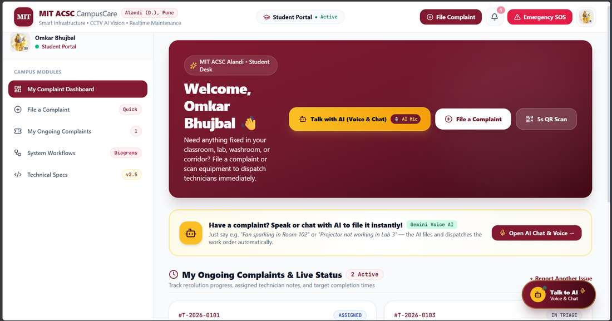
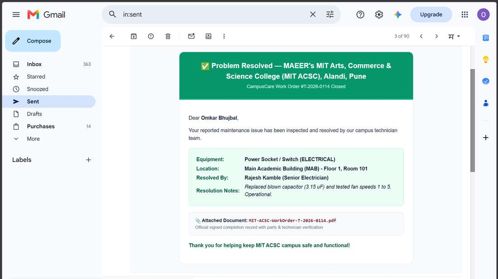
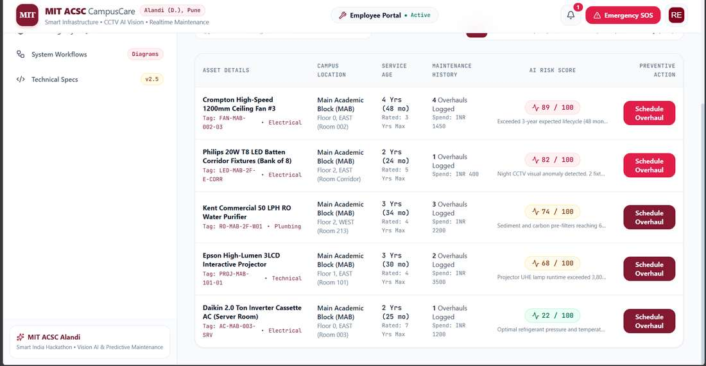
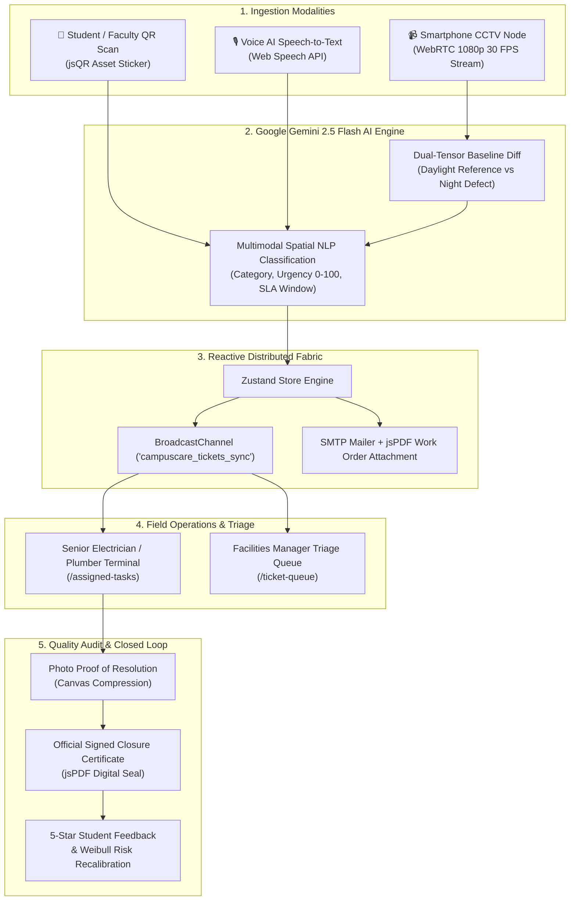

<div align="center">

# 🏫 MIT ACSC CampusCare / InfraMind AI
### Autonomous Campus Infrastructure Intelligence, Multimodal Vision AI & Real-Time Maintenance Operations

[](https://inframind-ai.omkardbz123.workers.dev)
[](https://react.dev/)
[](https://www.typescriptlang.org/)
[](https://vitejs.dev/)
[](https://tailwindcss.com/)
[](https://ai.google.dev/)
[](https://webrtc.org/)

**MAEER's MIT Arts, Commerce & Science College, Alandi (D.), Pune**  
*Autonomous Higher Education Smart Infrastructure Management & Predictive Maintenance Platform*

🌐 **Live Application**: [https://inframind-ai.omkardbz123.workers.dev](https://inframind-ai.omkardbz123.workers.dev)  
📊 **System Workflows Blueprint**: [https://inframind-ai.omkardbz123.workers.dev/workflow](https://inframind-ai.omkardbz123.workers.dev/workflow)  
📐 **Technical Architecture Specs**: [https://inframind-ai.omkardbz123.workers.dev/technicality](https://inframind-ai.omkardbz123.workers.dev/technicality)  
📱 **Smartphone CCTV Camera Node**: [https://inframind-ai.omkardbz123.workers.dev/cctv-node](https://inframind-ai.omkardbz123.workers.dev/cctv-node)

---

</div>


## 📸 Application Screenshots

### Student Portal — AI-Assisted Incident Reporting


### Automated Work Order Closure


### Predictive Asset Maintenance



## 📌 Table of Contents
- [Executive Overview](#-executive-overview)
- [The Problem vs. InfraMind AI Solution](#-the-problem-vs-inframind-ai-solution)
- [Core System Architecture](#-core-system-architecture)
- [Key Features & Innovations](#-key-features--innovations)
  - [1. Multimodal Zero-Friction Reporting](#1-multimodal-zero-friction-reporting)
  - [2. Google Gemini 2.5 Flash Vision AI Triage](#2-google-gemini-25-flash-vision-ai-triage)
  - [3. Zero-Hardware Autonomous Night CCTV Vision AI](#3-zero-hardware-autonomous-night-cctv-vision-ai)
  - [4. Sub-5ms Reactive State Fabric & Mailer](#4-sub-5ms-reactive-state-fabric--mailer)
  - [5. Field Technician Terminal & Proof-of-Fix](#5-field-technician-terminal--proof-of-fix)
  - [6. Facilities Manager Central Triage Queue](#6-facilities-manager-central-triage-queue)
  - [7. Predictive Asset Maintenance & Campus Risk Map](#7-predictive-asset-maintenance--campus-risk-map)
- [End-to-End Operational Lifecycle](#-end-to-end-operational-lifecycle)
- [Role-Based Access Control (RBAC)](#-role-based-access-control-rbac)
- [Live Navigation & Route Map](#-live-navigation--route-map)
- [Technology Stack](#-technology-stack)
- [Local Setup & Development](#-local-setup--development)
- [Cloudflare Edge Deployment](#-cloudflare-edge-deployment)
- [Repository & Contributions](#-repository--contributions)

---

## 🚀 Executive Overview

Educational campuses spanning multiple academic wings, laboratories, libraries, and lecture halls face constant infrastructure breakdowns — unlit corridors, leaking plumbing lines, malfunctioning lab projectors, and burned fan capacitors. Traditional management relies on physical register books, fragmented phone calls, and delayed contractor dispatch, leaving hazards unaddressed for days.

**InfraMind AI (MIT ACSC CampusCare)** is an enterprise-grade smart campus operations platform that creates an **uninterrupted closed loop**:
1. **Detects** faults instantly via Student QR scanning, Natural Voice Speech AI, or Autonomous Night CCTV cameras.
2. **Triages** using Google Gemini 2.5 Flash Multimodal AI to classify categories, calculate urgency scores (0–100), and set deterministic SLA countdowns.
3. **Dispatches** in `< 2.5s` to the designated technician phone with audible chimes and auto-generated PDF work orders.
4. **Enforces Proof-of-Fix** requiring photographic evidence and logged replacement components before closure.
5. **Predicts Failures** using mathematical Weibull hazard curves to schedule preventative service *before* breakdowns disrupt lectures.

---

## ⚖️ The Problem vs. InfraMind AI Solution

| Metric / Scenario | Traditional College Maintenance | MIT ACSC CampusCare / InfraMind AI |
| :--- | :--- | :--- |
| **Fault Ingestion** | Manual handwritten register books at estate office | Instant QR code scan, Natural Voice STT, or photo capture (< 5s) |
| **Night Surveillance** | Dark corridors unnoticed until morning complaints | Autonomous CCTV AI scans lighting fixtures and opens tickets at night |
| **Triage & Priority** | Subjective human delays and misplaced paperwork | Gemini 2.5 Flash AI auto-categorization & deterministic SLA rating |
| **Technician Alert** | Manual phone calls or delayed morning briefing | Sub-5ms `BroadcastChannel` alert, audio chime & transactional PDF email |
| **Repair Accountability**| Verbal claims with no proof or part verification | Mandatory resolution photo proof, parts ledger & signed digital certificate |
| **Failure Prevention** | Reactive maintenance after total breakdown | Weibull hazard distribution modeling with interactive campus risk heatmaps |

---

## 🏛️ Core System Architecture



---

## 💡 Key Features & Innovations

### 1. Multimodal Zero-Friction Reporting
- **5-Second QR Asset Tagging**: Every fan, projector, AC, and electrical fixture has a unique QR barcode. Scanning instantly resolves Building, Floor, Wing, Room Number, and Equipment ID.
- **Voice AI Natural Language Mic**: Students speak naturally (*"The middle fan in Computer Lab 204 is vibrating violently"*). The system transcribes, extracts entities, and creates the ticket with zero typing.
- **Client-Side Photo Compression**: In-browser canvas rasterization compresses camera photos to `< 120 KB` Web-ready payloads before dispatch.

### 2. Google Gemini 2.5 Flash Vision AI Triage
- **Dual-Image Difference Engine**: Pairs a live camera frame with the calibrated daylight baseline to isolate dark zones and burned bulbs.
- **Automated Urgency Rating**: Scores safety hazards from 0 to 100 and computes strict SLA countdown windows:
  - 🚨 **CRITICAL (2 Hours)**: Power blackouts, water pipeline bursts, electrical sparks, server room heat.
  - ⚡ **HIGH (8 Hours)**: Lab projector bulb burnout during exams, dark corridor fixture, washroom tap leak.
  - 🛠️ **MEDIUM (24 Hours)**: Jammed fan capacitor, broken bench hinge, loose switchboard cover.
  - 🧹 **LOW (72 Hours)**: Minor wall paint peeling, scheduled dusting.

### 3. Zero-Hardware Autonomous Night CCTV Vision AI
- **Repurposed Smartphone Cameras**: Any ordinary smartphone becomes an enterprise surveillance camera node by scanning a QR code or visiting `/cctv-node`.
- **PeerJS WebRTC Mesh**: Streams encrypted 1080p 30 FPS video to the central monitoring hub with remote torch flashlight controls and battery telemetry.
- **Night Sweep Automation**: Runs periodic vision sweeps across corridor lighting, automatically opening tickets (`#T-AUTO-2026`) and dispatching them to the electrician before morning classes begin.

### 4. Sub-5ms Reactive State Fabric & Mailer
- **BroadcastChannel Inter-Process Bus**: Instant state replication across separate browser windows, mobile devices, and projector screens without server round-trip delays.
- **Audio Chime Synthesizer**: Web Audio API generates an instant 2-tone frequency chime (880Hz / 1174Hz) on the technician's phone when a new task is assigned.
- **Automated Work Order PDF Generator**: Automatically compiles official institutional work orders with MIT ACSC crest, barcode, and technician instructions.

### 5. Field Technician Terminal & Proof-of-Fix
- **One-Tap Task Acceptance**: Senior Electrician Rajesh Kamble taps *"Start Work"* to transition the ticket to `In Progress`.
- **Replacement Parts Ledger**: Logs consumed components (e.g. *Havells 3.15µF Capacitor, Philips 28W LED Driver*) and actual expenditure.
- **Mandatory Photo Proof**: Technicians must upload a photo of the repaired equipment. The system validates the fix and generates a digitally sealed completion certificate.

### 6. Facilities Manager Central Triage Queue
- **Visual SLA Countdown Timers**: Live color-coded countdown timers change from Green → Yellow (`< 4h`) → Flashing Red (SLA Breached).
- **1-Click Contractor Reassignment**: Instantly reassign work orders to backup technicians or outside electrical vendors.
- **Campus Emergency Hazard Broadcast**: Trigger high-priority broadcast banners across all student and faculty devices.

### 7. Predictive Asset Maintenance & Campus Risk Map
- **Weibull Hazard Rate Modeling**: Predicts component failure probability using:
  $$F(t) = 1 - e^{-\left(\frac{t}{\eta}\right)^\beta}$$
- **Interactive SVG Risk Heatmap**: Real-time architectural floor plans of the Main Academic Building and Central Library color-code high-risk zones from Green to Red.

---

## 🔄 End-to-End Operational Lifecycle

```
[01. Incident Reported] ➔ [02. Gemini AI Triage] ➔ [03. Instant Dispatch] ➔ [04. Field Repair] ➔ [05. Proof & Closure] ➔ [06. Feedback & AI Update]
```

1. **Detection**: Student scans QR or CCTV AI detects dark light at night.
2. **AI Triage**: Gemini 2.5 Flash categorizes issue, sets 8h SLA, and assigns Electrician.
3. **Dispatch**: Sub-5ms broadcast rings technician phone; work order PDF emailed.
4. **Field Repair**: Electrician isolates breaker, replaces driver/capacitor, and logs parts.
5. **Verification**: Electrician uploads photo proof; signed closure certificate generated.
6. **Closed Loop**: Student rates 5 stars; asset MTBF updated; campus risk score drops.

---

## 👥 Role-Based Access Control (RBAC)

The platform features seamless 1-click authentication for 5 institutional roles:

| Role | Demo User Account | Email | Primary Responsibilities |
| :--- | :--- | :--- | :--- |
| 🎓 **Student** | Omkar Bhujbal | `5454317@mitacsc.edu.in` | Scan QR codes, talk with AI voice mic, file complaints, track live status, rate fixes. |
| 👨‍🏫 **Faculty** | Dr. Rajiv Deshpande | `dr.deshpande@mitacsc.edu.in` | Class & lab emergency fault reporting, AV equipment dispatch, priority escalation. |
| ⚡ **Electrician** | Rajesh Kamble | `rajesh.electrician@mitacsc.edu.in` | Mobile work order terminal, breaker safety diagnostics, part logging, photo proof upload. |
| 🏢 **Estate Manager** | Er. Ramesh Kulkarni | `ramesh.manager@mitacsc.edu.in` | Campus triage queue, SLA countdowns, technician reallocation, emergency broadcasts. |
| 🏛️ **Principal / Dean**| Dr. B. B. Waphare | `principal.admin@mitacsc.edu.in` | Executive dashboard, monthly compliance audits, predictive budget allocation. |

---

## 🗺️ Live Navigation & Route Map

| Route | Page Name | Description |
| :--- | :--- | :--- |
| `/` | **Campus Overview** | Unified role-adaptive campus overview and action dashboard. |
| `/workflow` | **System Workflows** | Interactive visual workflow diagrams, step-by-step simulation, and swimlane matrix. |
| `/technicality` | **Technical Specs** | Deep architectural blueprints, data contracts, and WebRTC protocols. |
| `/report-fault` | **File Complaint** | Multi-modal reporting with voice STT, QR scanner, and photo attachment. |
| `/cctv-monitoring` | **CCTV Vision Hub** | Enterprise CCTV multi-camera control desk and Gemini AI inspection hub. |
| `/cctv-node` | **Smartphone CCTV** | Turns any mobile device into an active 1080p WebRTC camera node. |
| `/assigned-tasks` | **Technician Terminal** | Field repair work order management, part logging, and proof-of-fix upload. |
| `/ticket-queue` | **Manager Triage** | Estate manager dispatch queue, SLA countdowns, and contractor reallocation. |
| `/risk-map` | **Campus Risk Map** | Interactive architectural SVG floor plan heatmap of failure probabilities. |
| `/quick_login` | **1-Click Login** | Instant institutional role selector for rapid evaluation. |

---

## 🛠️ Technology Stack

- **Frontend Framework**: React 19, TypeScript, Vite 6
- **Styling & Design System**: Tailwind CSS, Lucide Icons, Plus Jakarta Sans, JetBrains Mono
- **Edge Deployment**: Cloudflare Workers, Wrangler Edge Triggers
- **Generative AI & Vision**: Google Gemini 2.5 Flash API (REST / JSON Schema)
- **Real-Time Video Mesh**: WebRTC, PeerJS, STUN/TURN ICE Traversal, HTML5 Canvas 2D
- **State & Communication**: Zustand, BroadcastChannel API, LocalStorage Hydration, Web Audio API
- **Document & QR Generation**: jsPDF, html2canvas, jsQR, qrcode.react, Canvas Rasterizer
- **PWA Capabilities**: Service Workers, Web App Manifest, Offline LocalStorage Queue

---

## 💻 Local Setup & Development

### Prerequisites
- Node.js 18.x or higher
- npm 9.x or higher

### Installation Steps
```bash
# 1. Clone the repository
git clone https://github.com/omkardbz123/inframind_Ai.git
cd inframind_Ai

# 2. Install dependencies
npm install

# 3. Configure environment variables (optional for local Gemini API)
# Create a .env file:
# VITE_GEMINI_API_KEY=your_google_gemini_api_key

# 4. Start Vite development server
npm run dev

# 5. Open browser at:
# http://localhost:5173
```

---

## ☁️ Cloudflare Edge Deployment

The production application is compiled with zero-bundle asset uploading to Cloudflare Workers:

```bash
# 1. Build optimized production bundle
npm run build

# 2. Deploy to Cloudflare Workers Edge
npx wrangler deploy --no-bundle
```

---

## 📄 License & Institutional Credits

Developed for **MAEER's MIT Arts, Commerce & Science College, Alandi (D.), Pune**  
Project: **InfraMind AI / CampusCare Infrastructure Platform**  
Smart India Hackathon • Next-Generation Smart Campus Operations

*Repository*: [https://github.com/omkardbz123/inframind_Ai](https://github.com/omkardbz123/inframind_Ai)  
*Live System*: [https://inframind-ai.omkardbz123.workers.dev](https://inframind-ai.omkardbz123.workers.dev)

